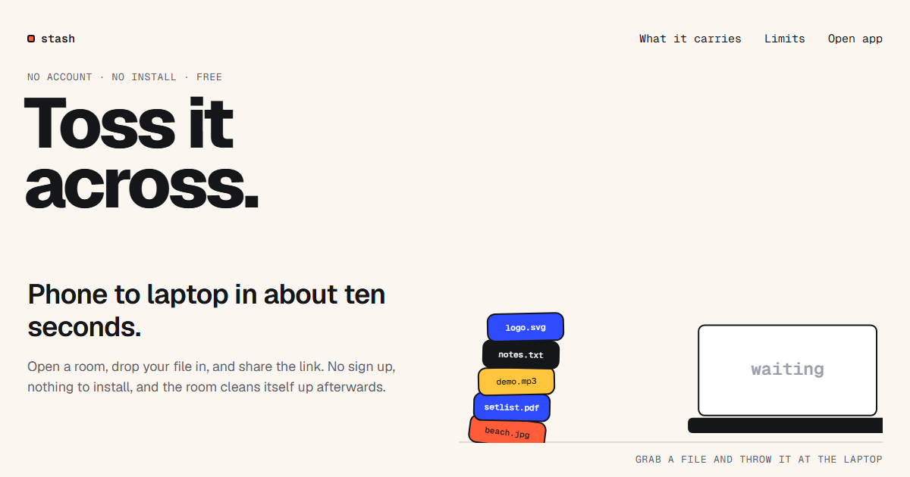

<div align="center">



<br />
<br />

# Stash

### Toss it across.

**A file, a link, your screen — from the device in your hand to the one on your desk.<br />No account. No install. Open the page and drop.**

<br />

[](https://stash-ed.vercel.app)
[](https://stash-ed.vercel.app/pricing)
[](LICENSE)

[](https://github.com/Hamzaisadev/Stash/actions/workflows/ci.yml)


<br />

**[Open Stash →](https://stash-ed.vercel.app)**  ·  [How it works](#how-it-works)  ·  [Self-host](#self-hosting)  ·  [Pricing](#pricing)

</div>

<br />

---

<br />

## The thirty-second version

You have a photo on your phone. You want it on your laptop.

Today that means emailing yourself, or opening a chat app and messaging yourself, or finding a cable, or signing into a cloud drive on a machine that is not yours.

With Stash you open the same page on both devices and drag the file. It lands on the other screen in real time. Nothing to install, nothing to sign up for, and in 24 hours the room and everything in it is gone.

```
  ┌─────────────┐                              ┌─────────────┐
  │   phone     │   ──  drop  ──▶  room  ──▶   │   laptop    │
  │             │                              │             │
  │  beach.jpg  │        6-digit code          │  beach.jpg  │
  └─────────────┘        or a QR scan          └─────────────┘
                         or just the link
```

<br />

## How it works

| | |
|:--|:--|
| **1 · Drop** | Drag a file onto the page, or paste it straight from your clipboard. Nothing to install. |
| **2 · Share** | Send the room link, let them scan the QR code, or read out the 6-digit code. |
| **3 · Catch** | It lands on the other device in real time. Preview images and audio before downloading. |

<br />

## What it carries

<table>
<tr>
<td width="25%" valign="top">

### Files
`100 MB each · 10 per drop`

Any format. Send several at once and they arrive as one zip. Preview images, video and audio in the browser before you commit to a download.

</td>
<td width="25%" valign="top">

### Clipboard
`Last 30 entries, live`

Copy a link on your phone, paste it on your laptop a second later. Shared across every device in the room.

</td>
<td width="25%" valign="top">

### Screen
`WebRTC, browser to browser`

Cast a tab, a window or your camera to everyone in the room. No meeting link, no plugin, no scheduling.

</td>
<td width="25%" valign="top">

### Voice notes
`Recorded in the browser`

Hit record, drop it in the room, play it back anywhere. Useful when typing the explanation is slower than saying it.

</td>
</tr>
</table>

<br />

## Control over what you send

- **Burn after download** — set a file to delete itself after a chosen number of downloads.
- **Timed expiry** — from 1 minute to 7 days. The default is 24 hours.
- **Locked rooms** — a 6-digit code, stored only as a bcrypt hash, or host approval for each person who asks to join.
- **Auto-discovery** — devices sharing a public IP land in the same room without typing anything.

<br />

## What Stash does, and what it does not

Stated plainly, because a security claim is only worth anything when the limitation sits next to it.

<table>
<tr>
<td width="50%" valign="top">

**It does**

- Encrypt in transit, and at rest via the storage provider
- Store room codes and file passwords as bcrypt hashes only
- Delete files on expiry, or the moment they hit a download limit
- Ask for no account, no email, and run no tracking scripts

</td>
<td width="50%" valign="top">

**It does not**

- Offer end-to-end encryption. **Whoever runs the server can read what passes through it**
- Work as a backup. Everything in a room is on its way out
- Guarantee peer-to-peer transfer without a TURN relay — on most mobile networks it falls back to the server

</td>
</tr>
</table>

> [!IMPORTANT]
> Do not put anything in Stash that you would not trust a hosted service with.

<br />

## Pricing

Stash is **MIT licensed**. Self-host it and every limit below disappears — set `SELF_HOSTED_UNLIMITED=true` and you have the top tier free, forever, with no key and no check-in.

What the paid plans buy is the *hosted* instance: storage, bandwidth, the TURN relay that makes transfers work on cellular, and someone keeping it running.

| | **Free** | **Pro** — $6/mo | **Team** — $24/mo |
|:--|:--|:--|:--|
| Per file | 100 MB | 5 GB | 20 GB |
| Files per drop | 10 | 50 | 200 |
| Room lifetime | 24 hours | 30 days | Never expires |
| Max expiry | 7 days | 30 days | 1 year |
| Uploads per day | 2 GB | 100 GB | 1 TB |
| TURN relay | — | Included | Included |
| Clipboard history | 30 | 500 | 2,000 |
| Rooms | 10 | 100 | Unlimited |
| Custom branding | — | — | Included |

There is **no account**. A license key is a string you paste in once; it lives in your browser and is never tied to an identity we hold.

**[See full pricing →](https://stash-ed.vercel.app/pricing)**

<br />

## Self-hosting

<details>
<summary><b>Run your own instance — click to expand</b></summary>

<br />

### Prerequisites

- Node.js 18 or newer
- A Supabase project (Postgres + a storage bucket)

### 1. Clone

```bash
git clone https://github.com/Hamzaisadev/Stash.git
cd Stash
```

### 2. Set up the database

Run `backend/schema.sql` in your Supabase SQL editor, then create a storage bucket named `stash-files`.

Upgrading an existing instance? Run the migrations in `backend/migrations/` in order instead.

### 3. Configure the backend

Copy `backend/.env.example` to `backend/.env`:

```env
PORT=5000
NODE_ENV=development
SUPABASE_URL=https://your-project.supabase.co
SUPABASE_SECRET_KEY=your-supabase-service-role-key

# Required — the server refuses to start without it (min 32 chars).
# node -e "console.log(require('crypto').randomBytes(32).toString('hex'))"
TOKEN_SECRET=

# Required in production — comma-separated frontend origins.
ALLOWED_ORIGINS=https://your-frontend.vercel.app

# Lifts every plan limit on your own instance.
SELF_HOSTED_UNLIMITED=true
```

### 4. Install and run

```bash
cd backend  && npm install && npm run dev
cd frontend && npm install && npm run dev   # second terminal
```

Open `http://localhost:5173`. To test phone-to-laptop, use your machine's LAN IP rather than `localhost`.

### 5. Deploy

The frontend is static — Vercel works well. **The backend must be deployed separately:** it needs a persistent process for WebSockets, so Vercel is not suitable. Railway, Fly.io and Render all work. Avoid hosts that sleep on inactivity, which drops socket connections and clears in-memory room state.

Then set the frontend's environment variables:

```env
# Required. Without it, production builds call /api on the frontend's own
# origin, which returns the SPA's HTML instead of JSON, and nothing works.
VITE_BACKEND_URL=https://your-backend.up.railway.app

# Strongly recommended: without a TURN relay, peer-to-peer transfer and
# screen sharing fail behind symmetric NAT (most mobile networks).
VITE_TURN_URL=
VITE_TURN_USERNAME=
VITE_TURN_CREDENTIAL=
```

### Optional: enable billing

Only needed if you are running a paid instance. Leave it all unset and every request is served on the Free plan. See the billing block in `backend/.env.example`.

</details>

<br />

## Development

```bash
cd backend  && npm test                          # vitest
cd frontend && npx eslint src --max-warnings=0   # lint
cd frontend && npm run build                     # production build
```

All three run in CI on every pull request.

**Architecture**

```
backend/
  src/
    server.js       Express + Socket.io, CORS, cleanup timer
    controller.js   rooms, uploads, downloads, previews
    routes.js       API surface
    billing/        plans, license keys, entitlements, webhooks
    utils/auth.js   room + host token signing
  migrations/       numbered, run in order
  schema.sql        fresh installs

frontend/
  src/
    pages/          Landing, AppPage, Pricing, Legal
    hooks/useStash  sockets, uploads, WebRTC, the whole client
    data/           landing + pricing copy (numbers must match the backend)
    styles/         scoped CSS per surface
```

<br />

## Known limitations

Honest list, not a roadmap of excuses. Tracked in [`docs/ROADMAP.md`](docs/ROADMAP.md).

- **Single backend instance.** Room host, clipboard and quota state is in-process. Scaling out requires moving it to Redis plus the socket.io Redis adapter.
- **Uploads pass through server memory.** Large concurrent transfers are memory-bound. Presigned direct-to-storage uploads are the fix, and they are what unlocks raising the file size cap.
- **Peer-to-peer needs TURN.** Without a relay it fails behind symmetric NAT, which is most mobile carriers and many offices.

<br />

## Contributing

Issues and pull requests are welcome. Please read [`CONTRIBUTING.md`](.github/CONTRIBUTING.md) first — and open an issue before building anything large, since Stash deliberately stays narrow.

Found a security issue? **Do not open a public issue.** See [`SECURITY.md`](.github/SECURITY.md).

<br />

## License

[MIT](LICENSE) © Hamza Ishaq

Use it, fork it, sell it, run it yourself. The hosted instance at `stash-ed.vercel.app` is the only thing being charged for, and even that is free up to 100 MB a file.

<br />

<div align="center">

**[Open Stash →](https://stash-ed.vercel.app)**

<sub>Built because emailing yourself a file is a ridiculous way to move it three feet.</sub>

</div>
